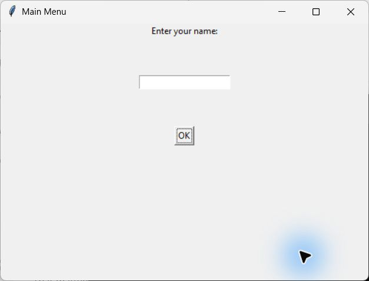
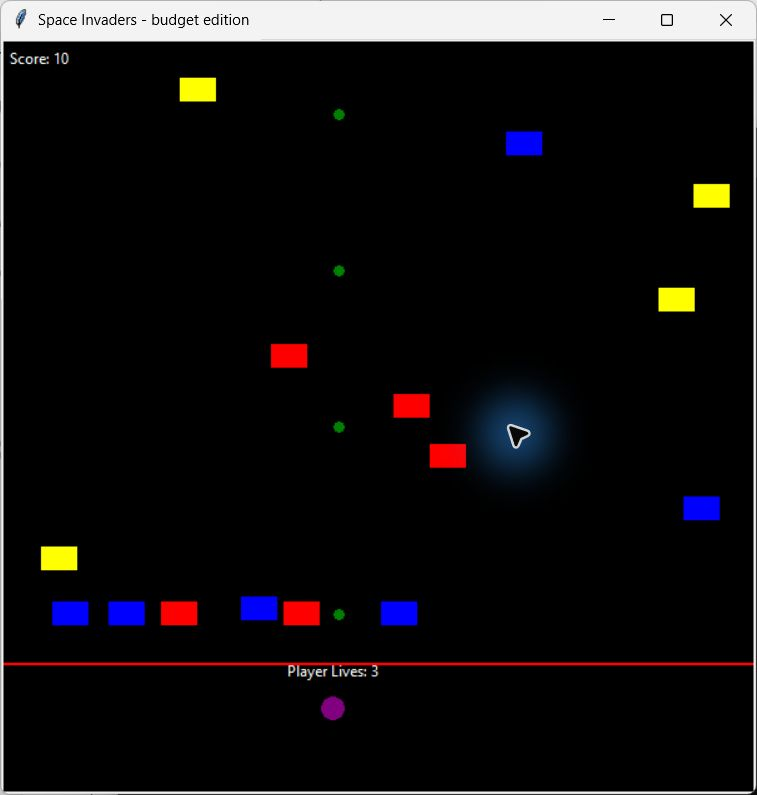
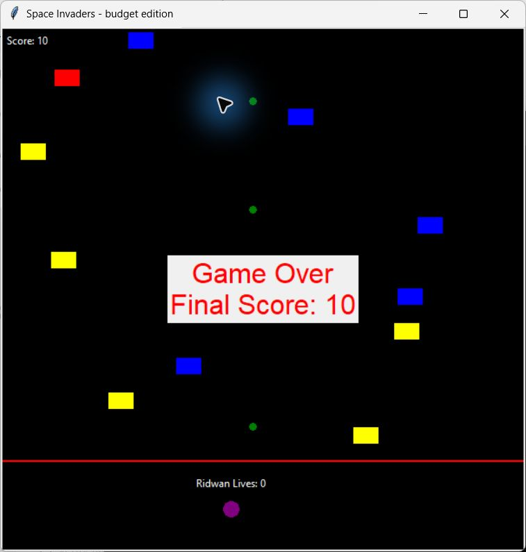

# Space Invaders

A lightweight Space Invaders-style desktop game built with Python and Tkinter. Move the player around the arena, avoid letting enemies cross the red defence line, and score points as the ship's automatic projectiles destroy incoming targets.

## Features

- Randomly generated enemies in multiple colours
- Automatic projectile firing and collision detection
- Score tracking and a three-life system
- Increasing enemy speed as the game progresses
- Player-name entry and game-over summary

## Code design

The game is contained in one Python module, but its responsibilities are separated into object-oriented classes rather than being implemented as one procedural script:

- **`Player`** owns the player's position, movement, lives, score, boundary checks, and game-over behaviour.
- **`Monster`** creates enemies, prevents overlapping initial positions, controls their movement, and removes enemies that cross the defence line.
- **`Projectile`** owns projectile movement and collision detection. Its reusable `is_collision` method performs an axis-aligned bounding-box intersection check.
- **`MainMenu`** isolates player-name input from the game screen.
- **`Game`** acts as the coordinator. It creates the canvas and game entities, binds keyboard input, stores active projectiles, schedules updates, and controls enemy generation.

Tkinter provides an event-driven game loop. Keyboard events call the player's movement methods, while recurring `after(...)` callbacks update projectiles, move enemies, generate new enemies, and increase the timer without blocking the interface. The `Game` object uses composition—it owns and coordinates `Player`, `Monster`, and `Projectile` objects—while each entity encapsulates its own state and behaviour. This keeps the gameplay logic modular even though the project is intentionally small and dependency-free.

## Controls

Use the arrow keys to move up, down, left, and right. Projectiles fire automatically.

## Run locally

Python 3.10 or newer is recommended. The game uses only the Python standard library, so no third-party packages are required.

```bash
python main.py
```

## Screenshots

### Start screen



### Gameplay



### Game over


